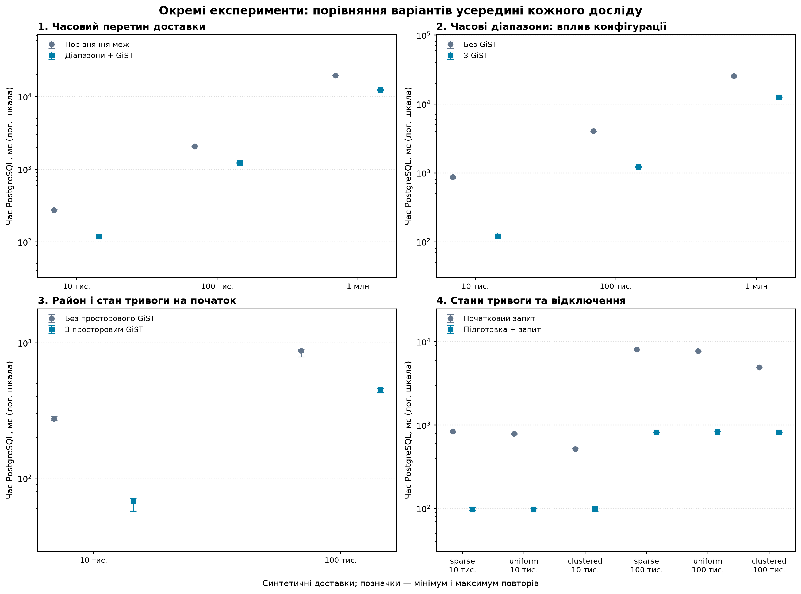

# Просторово-часовий аналіз логістичних даних

Дослідний прототип сховища даних для інтеграції логістичних операцій із повітряними тривогами, погодою та сценаріями відключень. Мета роботи — порівняти способи просторово-часового зіставлення даних і обґрунтувати вибір конфігурацій запитів для прототипу.

## Можливості

- Завантаження й перевірка підготовлених наборів у PostgreSQL.
- Розрахунок тривалості перетину доставки з повітряними тривогами.
- Визначення стану тривоги та модельного відключення на початку доставки.
- Приєднання погодного контексту та дослідне зіставлення координат із районами в PostGIS.
- Порівняння часових і просторових запитів, індексів GiST та підготовлених станів.

## Дані та межі дослідження

Контрольний зріз містить 371 історичний запис тривог Києва з [Порталу даних Києва](https://data.kyivcity.gov.ua/dataset/statystyka-povitrianykh-tryvoh-u-misti-kyievi/resource/5e4fb8a8-f0c8-4a12-885f-192d1f0dba75) за липень–вересень 2026 року, 500 синтетичних доставок і 2 208 модельних погодинних записів Open-Meteo для однієї точки. Відключення й координати доставок також синтетичні; районні контури є неофіційними та використовуються для досліду.

Час у первинному файлі тривог для проєкту прийнято як `Europe/Kyiv` і нормалізовано в UTC. Окреме документальне підтвердження від розпорядника джерела в наявних матеріалах відсутнє. Показник опадів стосується години перед погодною міткою, а не всієї доставки. Тривалість експозиції до відключень і несприятливої погоди не обчислюється.

Результати характеризують дослідні дані й конфігурації: вони не вимірюють фактичні затримки та не доводять вплив подій на реальну логістику. Джерела й обмеження описано в [реєстрі джерел](docs/02_source_registry.md) та [контрактах даних](docs/03_data_contracts.md).

## Результати

Для контрольного зрізу 154 із 500 модельних доставок перетнули тривогу; сукупний час перетину становив 293 671 секунду. У просторовому знімку 255 синтетичних точок мають один збіг із дослідними контурами, 245 — жодного, неоднозначних збігів немає.

Проведено чотири серії експериментів. Наприклад, для просторово-часового запиту на 10 000 синтетичних точок медіана п'яти вимірів становила 275,192 мс без просторового GiST і 67,789 мс із ним. Вимірювання виконано на одному комп'ютері з прогрітим кешем; витрати на створення й підтримку індексу в ці значення не включено. Повні умови, порівняння та застереження — у [підсумку дослідження](docs/34_research_synthesis.md).



## Запуск і перевірка

Потрібні Python 3.13, Docker Desktop із Docker Compose, залежності з `requirements.txt` і підготовлені локальні дані. Для перегляду баз можна використовувати pgAdmin.

**Дані й `.env` не входять до Git-репозиторію.** Саме клонування не створює заповнених баз. Якщо доступний комплект передачі з архівами коду та даних, відновлення в нову папку й створення ізольованих баз описано в [інструкції відновлення](docs/37_handoff.md). Комплект даних не зашифрований; перед його передачею потрібно перевірити права на зовнішні матеріали, зокрема районні контури.

Для вже створених і заповнених баз початкової робочої копії, після запуску Docker Desktop, із кореня проєкту в PowerShell:

```powershell
docker compose -f compose.yaml -f compose.spatial.yaml --profile spatial-research start db spatial-db
.\.venv\Scripts\python.exe -m scripts.verify_demo
```

Успішна перевірка повертає `"status": "verified"`. Вона виконує запити лише для читання та перевіряє актуальність просторового знімка на початку і наприкінці. Для відновленої копії застосовуються команди та порти з [інструкції відновлення](docs/37_handoff.md). Параметри підключення, запити та контрольні значення наведено в [інструкції для pgAdmin](docs/35_pgadmin_demo.md).

Автоматичні тести із встановленими залежностями:

```powershell
.\.venv\Scripts\python.exe -m pytest -q
```

## Структура проєкту

| Шлях | Вміст |
|---|---|
| `docs/` | Модель, джерела, експерименти, перевірка та відтворення |
| `scripts/` | Підготовка, завантаження, перевірки та експерименти |
| `sql/` | Схеми, аналітичні запити та запити для pgAdmin |
| `notebooks/` | Первинний огляд даних |
| `reports/` | Збережені вимірювання, плани запитів і результати дослідження |
| `tests/` | Автоматичні перевірки |

Порядок повторного запуску та перелік локальних файлів наведено в [документі передачі](docs/37_handoff.md). Відновлення перевірено на тому самому комп'ютері; перевірка на іншій машині окремо не проводилася.
