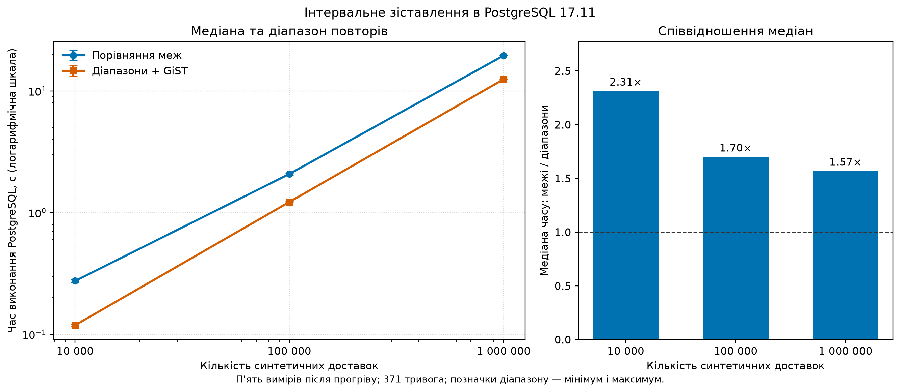

# 13. Аналіз результатів інтервального зіставлення

## Дані та метод

Проаналізовано результати серії з `reports/postgres_benchmark_20261105/measurements.csv`: для кожної з двох реалізацій і кожного з трьох обсягів є п'ять вимірювань після окремого прогріву. Показник — час виконання сервера PostgreSQL із `EXPLAIN ANALYZE`; передавання рядків клієнту й побудова індексу не враховані. Плани, параметри та умови зафіксовано в `docs/12_postgres_benchmark_results.md` та метаданих серії.

На лівій частині графіка показано медіани, а рисками — мінімум і максимум п'яти повторів. Обидві осі логарифмічні; прямий відрізок між точками не доводить конкретної асимптотичної складності. Права частина показує відношення медіани базового часу до медіани часу діапазонного запиту; значення понад 1 означає менший час діапазонного варіанта в цій серії.

| Синтетичних доставок | Медіана порівняння меж, мс | Медіана діапазонів, мс | Відношення медіан | Зменшення медіанного часу |
|---:|---:|---:|---:|---:|
| 10 000 | 274,385 | 118,694 | 2,31 | 56,74% |
| 100 000 | 2 078,504 | 1 223,403 | 1,70 | 41,14% |
| 1 000 000 | 19 553,942 | 12 478,806 | 1,57 | 36,18% |

Відношення розраховано як `медіана baseline / медіана range`, а зменшення — як `(1 − медіана range / медіана baseline) × 100%`. Це співвідношення окремо обчислених медіан, а не середнє попарних прискорень.

## Спостереження

Для цього набору та конфігурації діапазонний варіант мав менший медіанний час на всіх трьох обсягах. Відношення медіан зменшилося з 2,31 до 1,57 при зростанні кількості доставок. Це опис трьох виміряних точок, а не прогноз для більших даних.

Плани виконання показують використання `benchmark_alert_range_gist` у діапазонному варіанті. На мільйоні доставок в обох варіантах є операції з тимчасовими блоками, тому загальний час включає не лише пошук інтервалів, а й подальші сортування та агрегацію. Для пояснення їхнього внеску потрібен окремий аналіз планів і умов пам'яті.

Порівняння змінює разом **умову перетину** і можливість використати GiST-індекс. Тому ці дані не дозволяють окремо приписати всю різницю самому індексу. П'яти повторів на одному середовищі достатньо для початкового спостереження, але недостатньо для широких статистичних узагальнень. Менші набори є префіксами більшого, а кількість тривог фіксована — 371.

## Межі використання і наступні перевірки

Доставки синтетичні, тому наведені результати не оцінюють фактичні затримки. Не виміряно витрати на побудову чи підтримку індексу, повне споживання пам'яті, холодний кеш або час передачі результатів клієнту. Плани й швидкодія можуть змінюватися залежно від PostgreSQL, конфігурації та розподілу інтервалів.

Для розширення дослідження слід варіювати кількість і щільність тривог, перевірити діапазонний запит без GiST, окремо виміряти створення індексу та повторити серії за змінених параметрів пам'яті. Просторові зіставлення й Spark цією серією не досліджено.

## Відтворення графіка

З кореня проєкту `python -m scripts.plot_benchmark_results --output-dir reports/new_figures`. Скрипт читає сирі виміри, виключає прогріви та зберігає PNG і SVG; наявні файли не перезаписує. Мінімум і максимум повторів не є довірчими інтервалами. Обидва варіанти графіка збережено в `reports/postgres_benchmark_20261105/figures/`.
