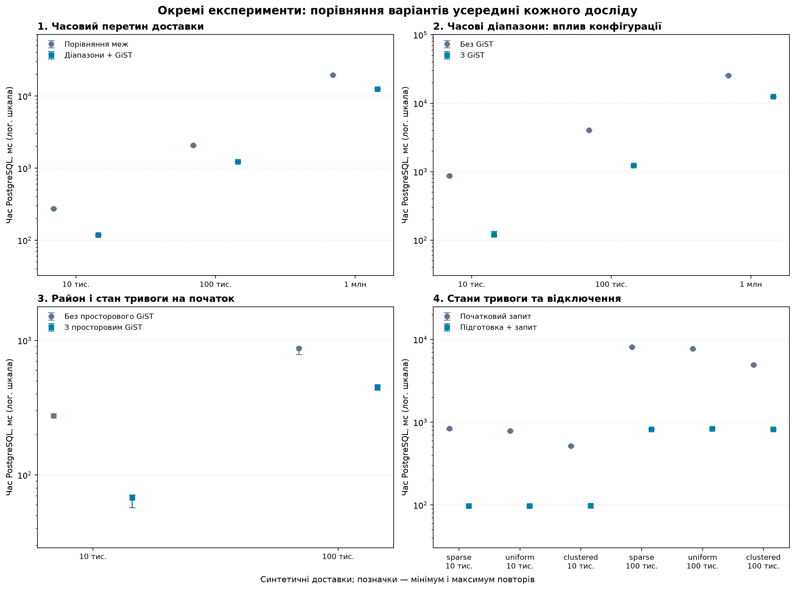

# 34. Підсумок експериментального дослідження

## Що саме досліджено

Мета — експериментально обґрунтувати вибір способів просторово-часового зіставлення для прототипу сховища логістичних даних. Проведено **чотири окремі серії**: дві про тривалість перетину доставки й тривоги, одну про район і стан тривоги на початку доставки та одну про стан тривоги й відключення на початку доставки. Їхні запити виконують різну роботу: абсолютні часи й коефіцієнти коректно порівнювати лише **всередині відповідної серії**.

Вхідний зріз — 371 запис повітряних тривог Києва за липень–вересень 2026 року, а також синтетичні доставки й, у відповідних сценаріях, синтетичні відключення та координати. Для погодного контексту окремо використовуються модельні погодинні дані Open-Meteo для однієї точки. Час первинних тривог прийнято як місцевий київський і переведено в UTC.

На рисунку показано медіани та мінімум–максимум повторів. На вертикальних осях — **логарифмічна шкала** часу; це діапазони окремих вимірів, а не довірчі інтервали.



## 1. Порівняння часових умов

Для обчислення перетину всієї тривалості доставки порівняно звичайні нерівності меж із діапазонним запитом, що мав доступ до GiST. Перед серією перевірено однаковість результатів. Для кожного обсягу виконано п'ять вимірів після прогріву.

| Синтетичних доставок | Нерівності, медіана, мс | Діапазони + GiST, медіана, мс | Відношення медіан |
|---:|---:|---:|---:|
| 10 000 | 274,385 | 118,694 | 2,31 |
| 100 000 | 2 078,504 | 1 223,403 | 1,70 |
| 1 000 000 | 19 553,942 | 12 478,806 | 1,57 |

Діапазонний варіант мав менший час у всіх трьох випадках. Одночасно змінилися форма умови й можливість використання GiST, тому різницю не можна повністю приписати індексу. Умови й плани — у [документі 13](13_benchmark_analysis.md).

## 2. Однаковий часовий діапазон із GiST та без нього

У другій серії порівняно однакову діапазонну умову на двох копіях тривог, одна з яких мала GiST-індекс. Дані та всі результати перевірено, кожен випадок виміряно п'ять разів після прогріву.

| Синтетичних доставок | Без GiST, медіана, мс | З GiST, медіана, мс | Відношення медіан |
|---:|---:|---:|---:|
| 10 000 | 873,905 | 120,536 | 7,25 |
| 100 000 | 4 039,795 | 1 238,200 | 3,26 |
| 1 000 000 | 25 438,571 | 12 542,784 | 2,03 |

У цих умовах індексована конфігурація була швидшою на кожному розмірі. Це порівняння конфігурацій з окремими фізичними копіями даних і планами оптимізатора; створення та підтримку індексу не включено. Деталі — у [документі 14](14_gist_ablation.md).

## 3. Район і тривога на початку доставки

Для синтетичних точок на десяти наявних неофіційних районних контурах порівняно дві конфігурації однакового запиту — із просторовим GiST та без нього. Пошук тривоги в обох однаковий і дозволений лише для перевірених неперетинних інтервалів. Усі результати звірено з незалежним еталоном; кожен випадок виміряно п'ять разів після прогріву.

| Синтетичних точок | Без просторового GiST, медіана, мс | З ним, медіана, мс | Відношення медіан |
|---:|---:|---:|---:|
| 10 000 | 275,192 | 67,789 | 4,06 |
| 100 000 | 870,800 | 451,138 | 1,93 |

Просторовий GiST використовувався у всіх вимірювальних планах індексованого варіанта. Точки рівномірно згенеровані в прямокутнику навколо контурів, а не за розташуванням реальних доставок. Контури залишаються неофіційними; їхнє використання не підтверджує адміністративної точності. Створення індексу не входить у наведений час запиту. Докладні умови, окремий одиничний вимір його створення й пробні серії — у [документі 33](33_spatiotemporal_benchmark.md).

## 4. Підготовлені стани тривоги та відключення

Для 250 синтетичних відключень у кожному профілі порівняно початковий запит із варіантом, який спочатку створює тимчасові стани та індекс, а потім зіставляє їх із доставками. Таблиця показує три повтори для `seed=42`: `sparse` — без накладань, `uniform` — рівномірно розміщені початки, `clustered` — події згруповані в часі.

| Профіль | Доставок | Початковий запит, медіана, мс | Підготовка + запит, медіана, мс |
|---|---:|---:|---:|
| sparse | 10 000 | 838,049 | 97,695 |
| uniform | 10 000 | 784,746 | 97,733 |
| clustered | 10 000 | 515,125 | 98,330 |
| sparse | 100 000 | 8 083,332 | 823,659 |
| uniform | 100 000 | 7 724,830 | 836,934 |
| clustered | 100 000 | 4 938,212 | 819,311 |

Підготовку та запит складено **в межах кожного повтору**, після чого обчислено медіану сум. Для цих сценаріїв і обсягів така конфігурація мала меншу медіану, але порівняння разом змінює матеріалізацію, індекс і форму умови. Воно не визначає окремий внесок кожної зміни. Тимчасовий стан узгоджений із транзакційним знімком, але сам не відображає пізніших змін. Докладніше — у [документі 24](24_cache_refresh_and_scaling.md).

## Висновки та практичний вибір

1. Для перевірених часових перетинів доцільно використовувати діапазонне зіставлення з GiST як **кандидатну конфігурацію** та контролювати правильність і фактичний план на своєму наборі даних.
2. Для перевіреного просторово-часового запиту просторовий GiST на точках також дав менший час. Його користь слід оцінювати разом із вартістю побудови та оновлення, яку ця серія повністю не виміряла.
3. Для перевірених сценаріїв підготовлені та індексовані тимчасові стани були швидшими навіть із включеною підготовкою. Їх слід оновлювати за правилами актуальності; це не автоматичне оновлення постійної вітрини.
4. Це **обґрунтований вибір конфігурацій для прототипу**, а не доказ нового універсального алгоритму. Зміна обсягу, розподілу, машини чи стану кешу може змінити результат.

У межах цих серій доставки, координати та відключення синтетичні. Їхні статуси не вимірюють фактичних затримок, тому результати не доводять причинного впливу тривог або відключень на реальну логістику. На районному рівні використовуються неофіційні контури. Усі виміри виконано на одному комп'ютері; менші набори доставок є префіксами більших. Час передачі результатів клієнту, повне використання пам'яті та холодний кеш не вимірювалися.

## Як перевірено й відтворити зведення

Скрипт `scripts.summarize_research` читає сирі `measurements.csv` і метадані чотирьох завершених серій, виключає прогріви, перевіряє кількість та унікальність повторів і звіряє перераховані показники з попередніми зведеннями. Для станів він складає підготовку й запит усередині кожного повтору. Вихідні контрольні суми — у `reports/research_synthesis_20261111/metadata.json`, усі 14 порівнянь — у `comparisons.csv` поряд із рисунками PNG та SVG.

Для повторного створення потрібні збережені звіти серій і Python-залежності; база та сирі набори доставок для самого **зведення** не потрібні. Оберіть нову папку:

```powershell
python -m scripts.summarize_research --output C:\Temp\dwh-research-synthesis-01
```

Повторне створення зведення читає наявні виміри; воно не повторює самих benchmark-експериментів. Контрольні суми текстових файлів залежать від їхніх фактичних байтів і можуть відрізнятися після зміни закінчень рядків Git.
